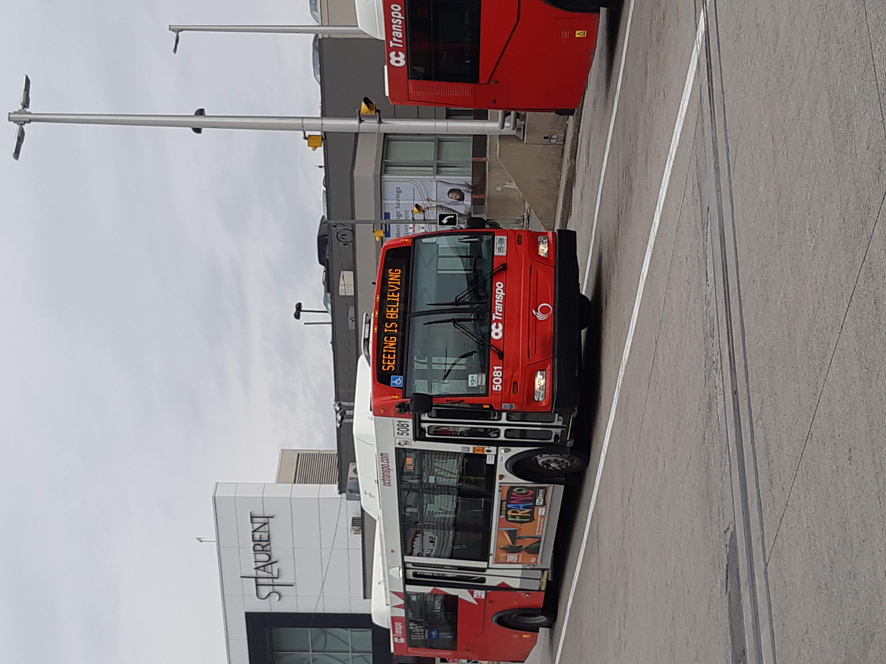
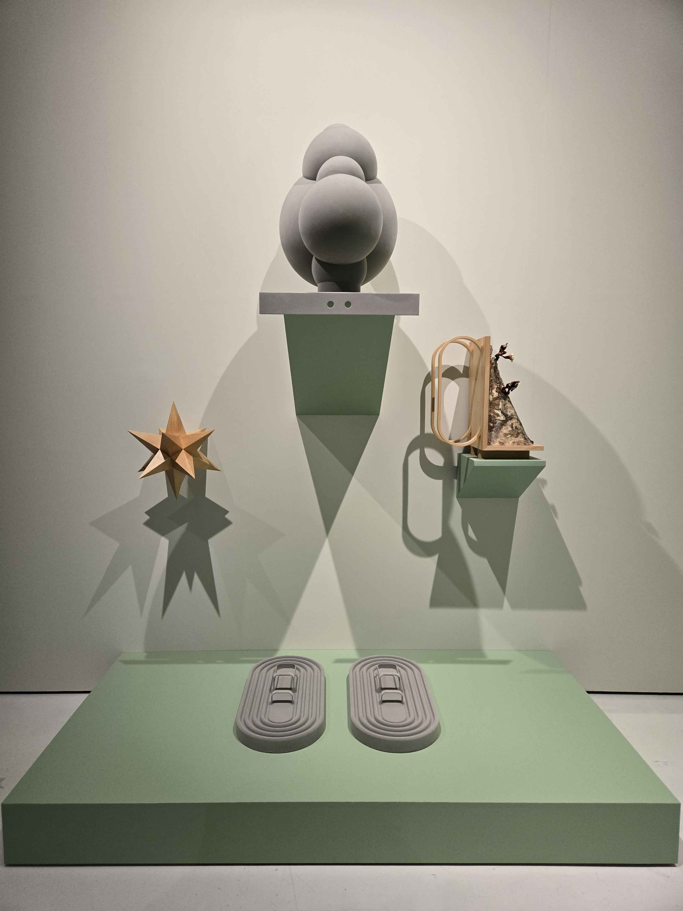
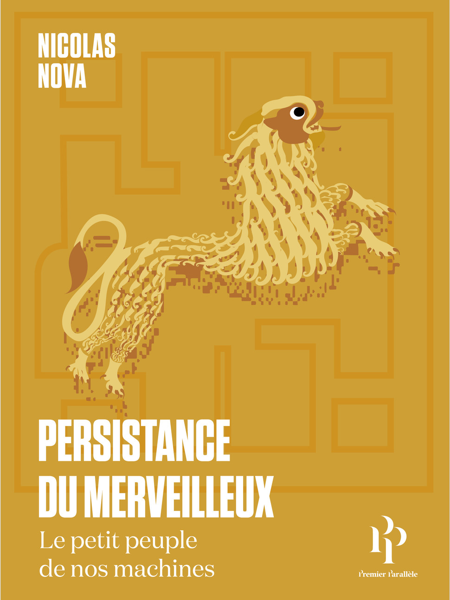
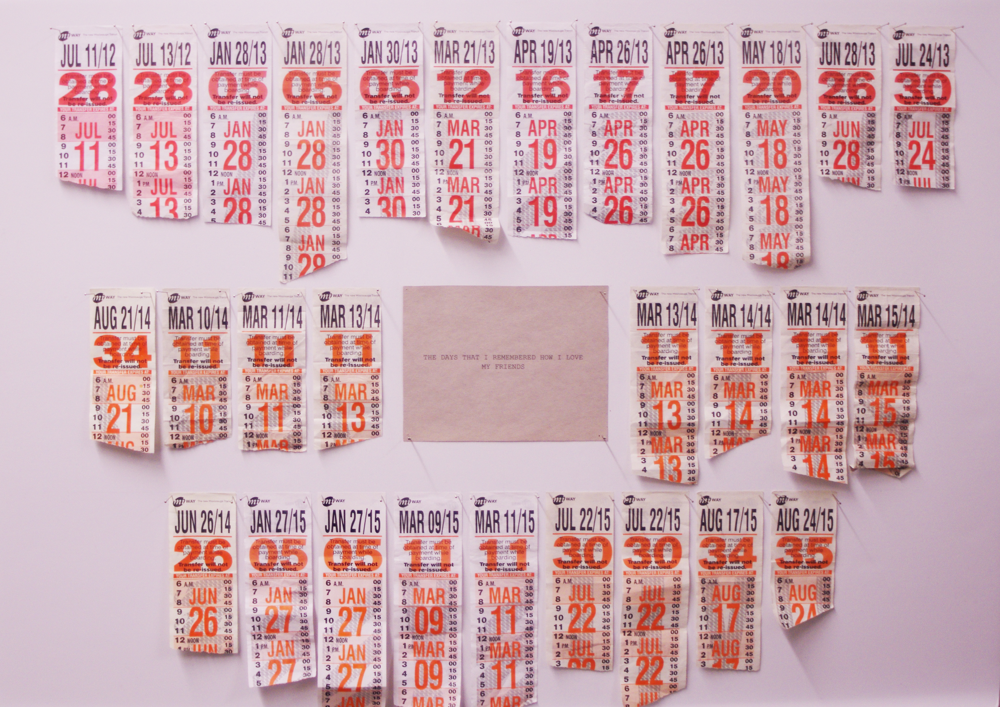
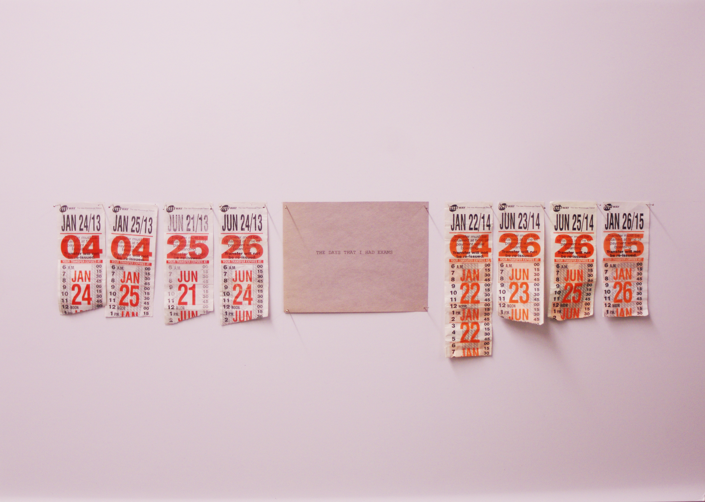

# 2026.11.11 Mapping my subject

## Magic and Design

## Persistance du merveilleux, Nicolas Nova

Highlights the way that folklore has made its way into our terminology around computing.

It's not just recasting our existing actions as magic (like "baguette magique"), but understanding how the ideas of folklore are persistent, magic followed us into our interactions with technology.

## Bus Transfers

This is my own work, collection of more than 200 bus transfers over the course of 4 years, each documented with the destination or purpose of my trip.

## Public Transportation as Designed Spaces

There exist rituals, encounters, and magic in public transportation.
