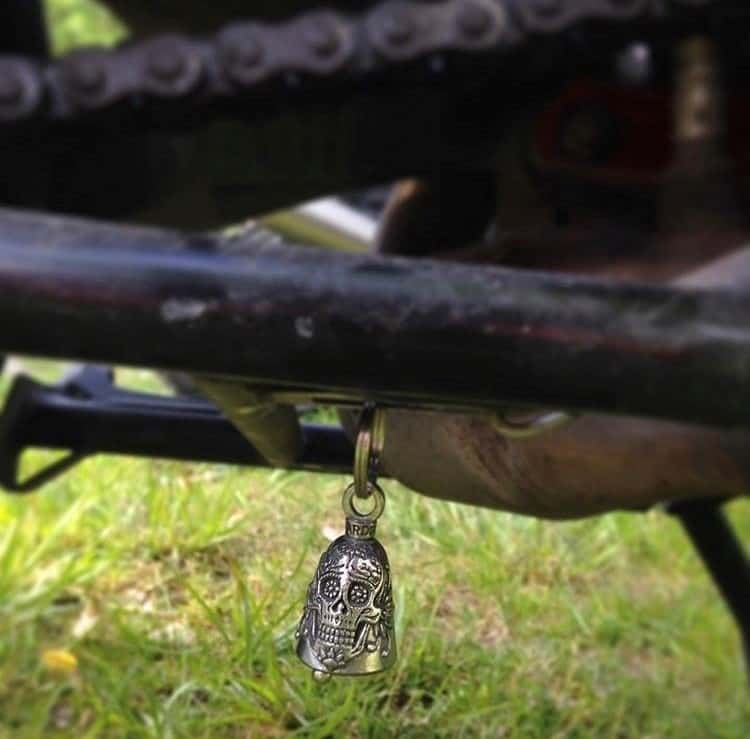
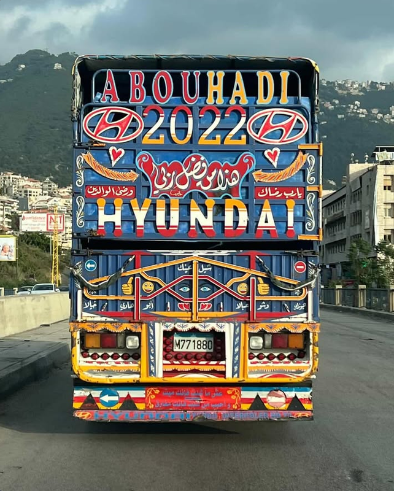
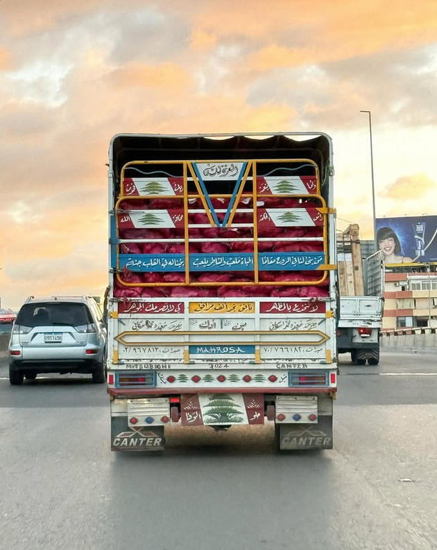
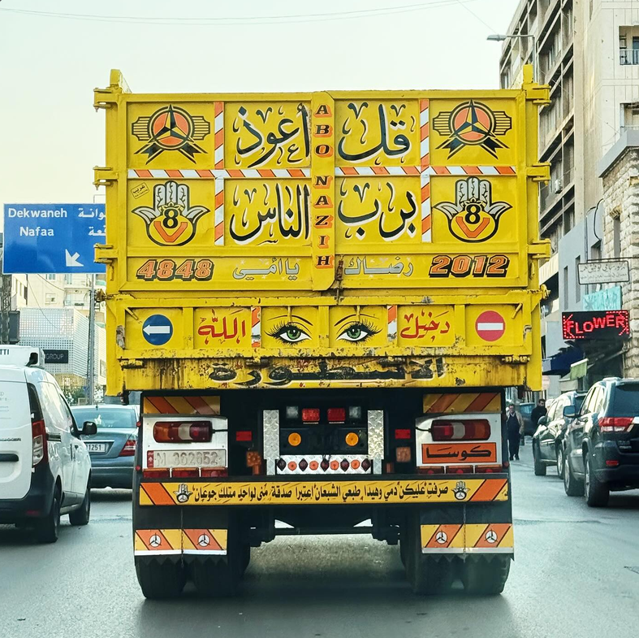
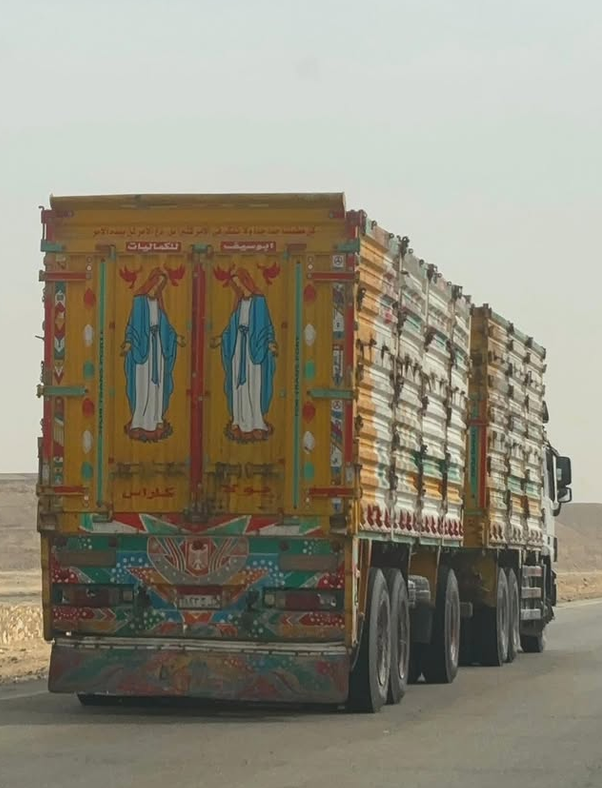

# Spiritual beliefs on transportation

## Motorcycle Guardian Bells
- british air force blamed gremlins for unexplained malfunctions
- keep the spirits away they hung bells in the cockpit
- when they returned home, they brought the superstitions to motorcycle
- tradition continues

## Lao travel trinkets
- peter got something in his car when he first got it
- a ginko leaf in his pocket when he went on a solo europe transportation
- he gave me a talisman when i left on my trip alone

## Camino de Santiago
- catholic idol given to me
- some people carry stones with them for their journey, laying the stone down when they had been released of their burdens

[Camino Stones](https://hiketheway.com/blog/symbolic-weight-significance-carrying-rock-camino)

## trucks of beirut
[Trucks of Beirut](https://www.instagram.com/trucksofbeirut/)
- name
- eyes
- the belief is that if someone looks at you with envy, it would curse you or bring bad energy, so the eyes reflect it back at them
- usually a blue eye
- hand of fatima/eye of fatima
- religious symbols

## trucks and cars in tanzania
- customised with religious symbols, often christian

## goblins
- someone returned from mexico and was ambushed by road goblins and began shaking packages with bells
