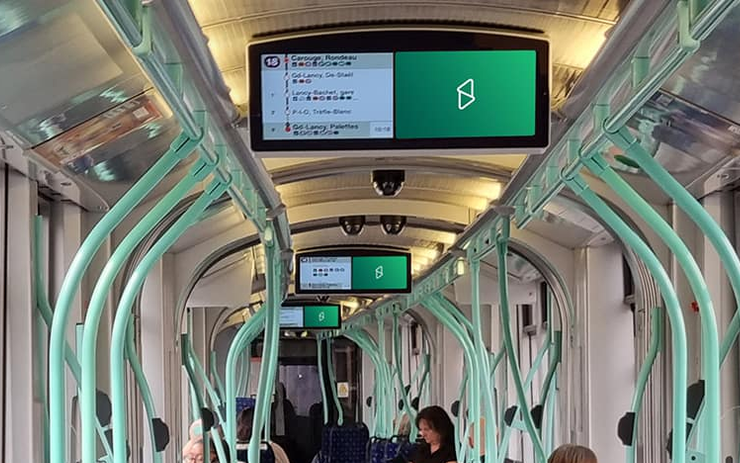

# Design of transportation systems

## Visual Design
- colour choices

### Print
- maps
- timetables
- sign layout and placement
- bus flags

### Digital
- screens on board

- live gps data lcd screens

## Experience Design
- interior materials
- bus shelter design

## System Design

## Sound
- chimes
- NSAS

## highly-designed spaces
ideas now before bed:
- colours
- screens onboard vehicles
- timing
- sign layout and placement
- detour communication
- live gps data
- names on trains
- names of belgian metro stations
- map design
- map colours

## PUBLIC TRANSIT AS DESIGNED SPACES

- bus and train interiors (swatches)
- liveries
- route maps (style, colour)
- scheduling
- NSAS
- heading sign (luminator screens)
- ads
- weekly mini-games (tpg, guess the location, guess the word)