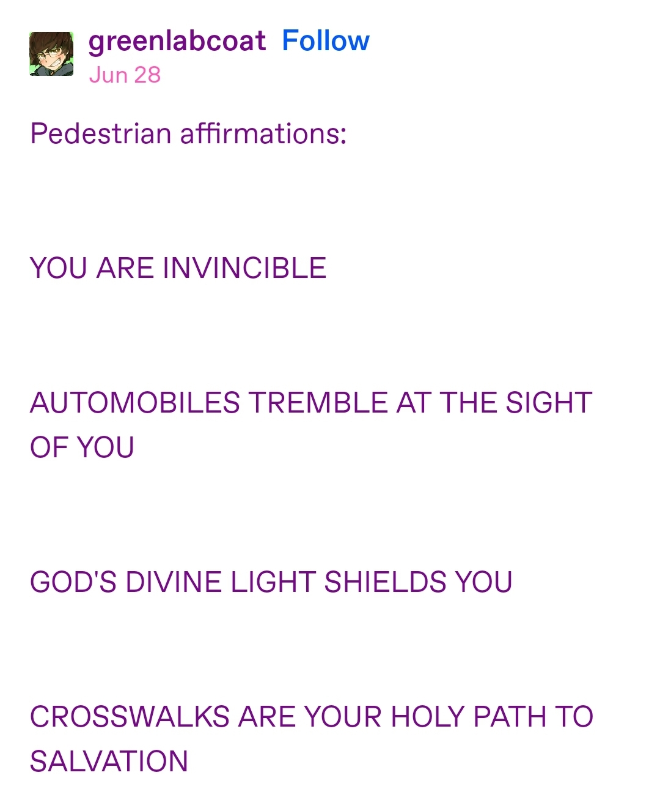
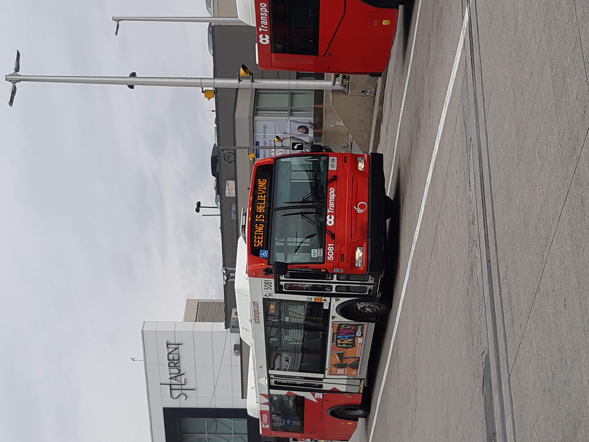

# BUS RITUALS

## QUESTIONS
1 - Encounterology begins with a simple decision: to multiply encounters.
5 - It does not seek to explain the world, but to create other ways of acting within it.

What encounters exist in public transportation that could be multiplied?

Where is there already magic in public transportation?

## KNOWN RITUALS

- always choosing the same bus seat
- having tickets which are a magical pass into the space
- taking the exact same tram every day
- saying thank you to the bus driver
- playing the same mini games
- waving down the bus driver

## PUBLIC TRANSIT AS DESIGNED SPACES

- bus and train interiors (swatches)
- liveries
- route maps (style, colour)
- scheduling
- NSAS
- heading sign (luminator screens)
- ads
- weekly mini-games (tpg, guess the location, guess the word)

## MYSTERY

- where are people going?
- who are they?
- is the bus alive?
- bus has feelings?? ?