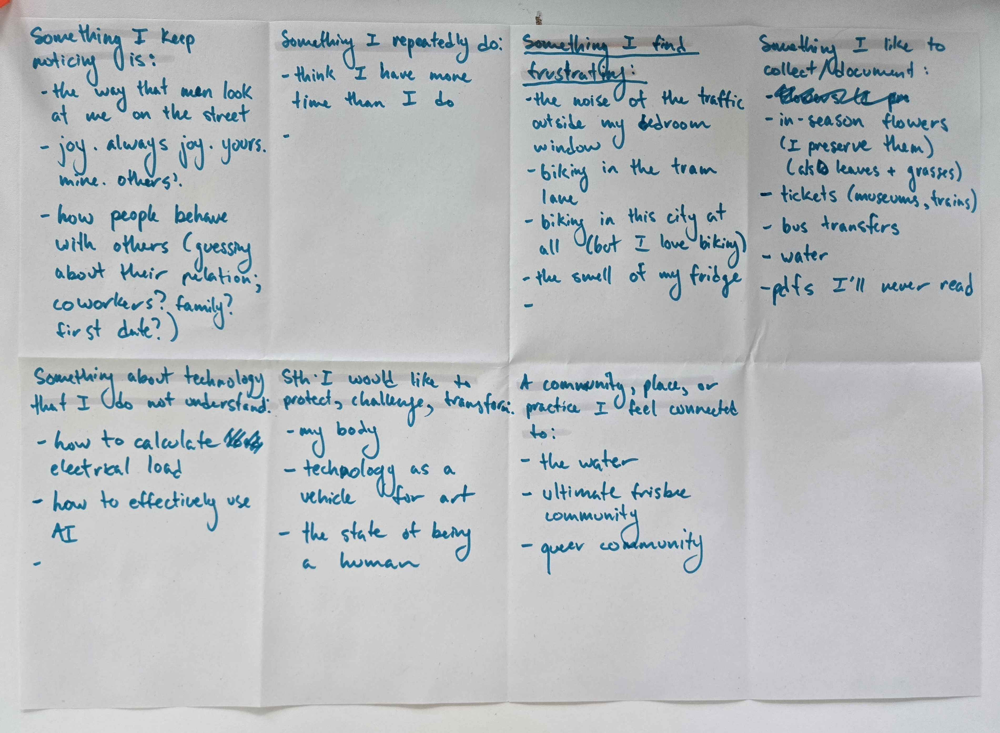
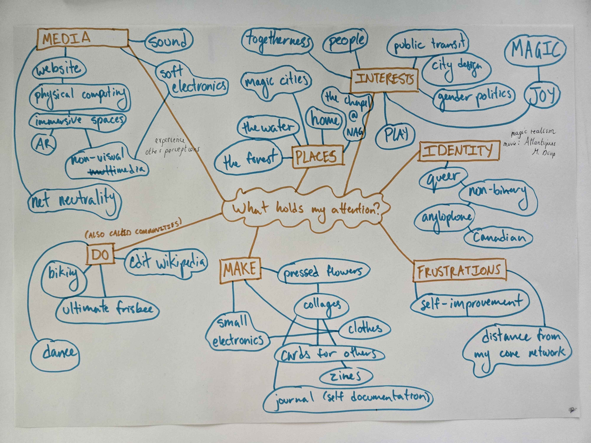
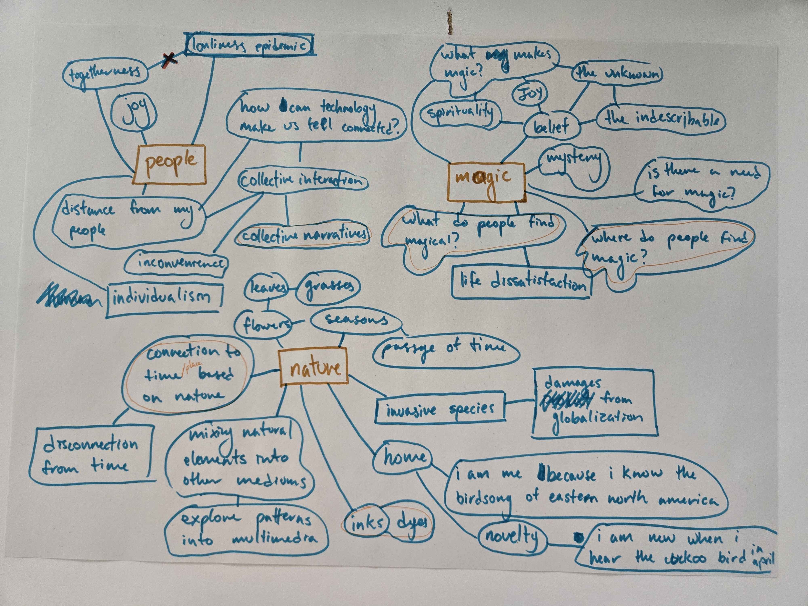
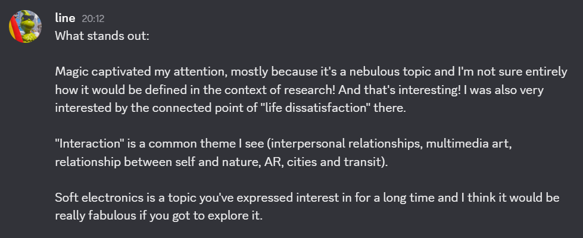

# GLITCH MANIFESTO
- everything is too relevant
- the core metaphor is that the refusal to participate in gendered society is akin to a glitch in the system, an error or undesigned effect
- this book is me

[Magical realism](https://en.wikipedia.org/wiki/Magical_realism)

# MIND MAP EXERCISE

I asked my best friend for comments on my mind maps, since they know me better than anyone else. I wanted more feedback about what was interesting or missing from my map.

soft electronics+magic+bodies

Interesting quotes that I'm thinking about today.

> We use "body" to give material form to an idea that has no form.
Russell, Glitch Manifesto

> i am me because i know the birdsong of eastern north america. i am new when i hear the cuckoo bird in april.
me, on how birds connect me to the present in place and time

> Do you believe in magic?